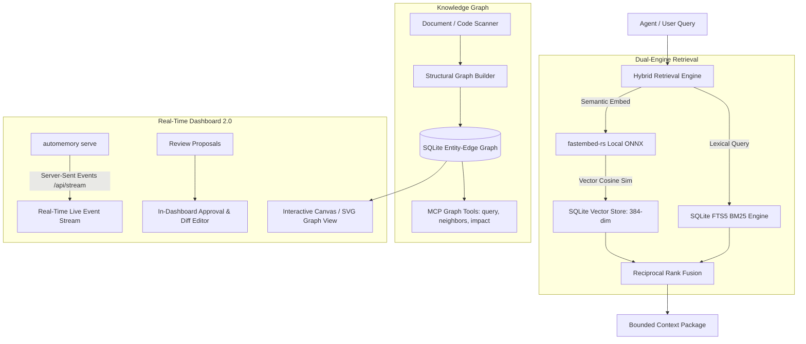

# Phase 2: Advanced Intelligence & Knowledge Graph (Approved Next)

## Goal
Upgrade AutoMemory Pro with pure local semantic vector embeddings, Reciprocal Rank Fusion (RRF), a structural codebase knowledge graph, Real-Time SSE Web Dashboard 2.0, and predictive pre-flight task advising.

---

## Architecture & Roadmap

---

## Planned Deliverables

### 1. Pure Local Semantic Vector Embeddings (`fastembed-rs`)
- **Engine**: Local ONNX runtime running natively in Rust without Python or Node.js.
- **Model**: `all-MiniLM-L6-v2` (quantized ONNX, 384 dimensions, ~23MB footprint, <10ms inference).
- **Storage**: SQLite table `memory_embeddings (memory_id TEXT PRIMARY KEY, embedding BLOB NOT NULL)`.
- **Hybrid RRF Scorer**: Combines FTS5 BM25 rank with vector cosine similarity:
  $$\text{Score}(d) = \frac{\alpha}{k + \text{rank}_{\text{FTS}}(d)} + \frac{\beta}{k + \text{rank}_{\text{Vector}}(d)}$$

### 2. Codebase Structural Knowledge Graph
- **Schema**:
  - `graph_entities`: `(id, project_id, entity_type, name, path, metadata)`
  - `graph_edges`: `(source_id, target_id, relation_type, confidence, created_at)`
- **MCP Tools**: `graph.query`, `graph.neighbors`, `graph.trace_impact`.
- Allows agents to inspect caller-callee hierarchies and affected files before executing changes.

### 3. Real-Time Web Dashboard 2.0 (SSE & Visual Graph)
- Server-Sent Events (`/api/stream`) streaming live tool events, memory updates, and sync pulses.
- Interactive canvas/SVG visual relationship graph of decisions, traces, and code files.
- In-dashboard review proposal decider (`/api/proposals`) and document revision diff inspector.

### 4. Predictive Pre-Flight Task Advising
- During `PreInvocation` and `PreToolUse`, evaluates incoming tasks against past `FailureRecord`s and `SuccessTrace`s.
- Injects ephemeral advice before execution to prevent repeating known errors in auto-approve mode.
