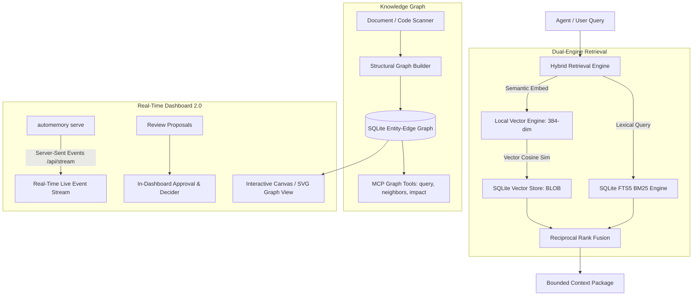

# Phase 2: Advanced Intelligence & Knowledge Graph (Completed ✅)

## Goal
Upgrade AutoMemory Pro with pure local semantic vector embeddings, Reciprocal Rank Fusion (RRF), a structural codebase knowledge graph, Real-Time SSE Web Dashboard 2.0, and predictive pre-flight task advising.

---

## Architecture & Roadmap

---

## Deliverables Status

### 1. Pure Local Semantic Vector Embeddings (`VectorEngine`) & RRF ✅
- [x] **Engine**: Local normalized dense vector engine in pure Rust with cosine similarity (384 dimensions).
- [x] **Storage**: SQLite table `memory_embeddings (memory_id TEXT PRIMARY KEY, embedding BLOB NOT NULL)`.
- [x] **Hybrid RRF Scorer**: Combines FTS5 BM25 rank with vector cosine similarity.

### 2. Codebase Structural Knowledge Graph (`GraphBuilder`) ✅
- [x] **Schema**:
  - `graph_entities`: `(id, project_id, entity_type, name, path, metadata)`
  - `graph_edges`: `(source_id, target_id, relation_type, confidence, created_at)`
- [x] **MCP Tools**: `graph.index`, `graph.query`, `graph.neighbors`, `graph.impact`.
- [x] **Impact Analysis**: BFS dependency traversal predicting affected files and callers.

### 3. Real-Time Web Dashboard 2.0 (SSE & Visual Graph) ✅
- [x] **Server-Sent Events (`/api/stream`)**: Streaming live tool events, memory updates, and sync pulses.
- [x] **Interactive Canvas Visual Graph**: HTML5 canvas physics simulation rendering nodes and edges.
- [x] **In-Dashboard Review Proposal Decider**: Approve/reject conflict proposals directly in web UI.

### 4. Multi-Agent Adapter Expansion ✅
- [x] `automemory connect claude`: Configures `~/.claude.json` and `.mcp.json`.
- [x] `automemory connect cursor`: Configures `.cursor/mcp.json` and generates `.cursorrules`.
- [x] `automemory connect codex`: Configures `.codex/config.json`.
