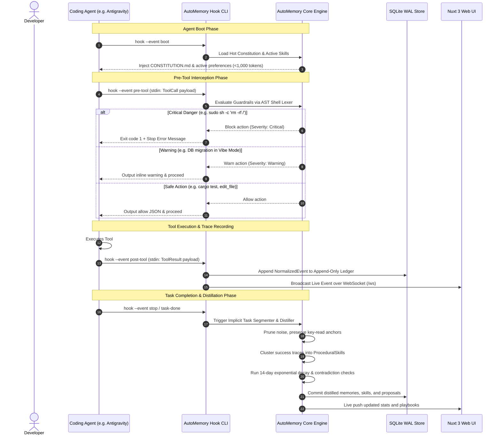

# How It Works: End-to-End Workflow & Lifecycle

## 1. The Autonomous Agent Lifecycle

AutoMemory interfaces with coding agents through an **out-of-process hook mechanism** and a standard **Model Context Protocol (MCP)** interface. This guarantees zero lock-in, zero runtime performance degradation for the host agent, and full crash isolation.

---

## 2. Step-by-Step Lifecycle Breakdown

### Phase 1: Bootstrapping & Context Injection (`boot`)
1. When an agent session starts, the host agent fires the `boot` hook.
2. AutoMemory resolves the active project by inspecting workspace paths, Git root, or `$AGENTMEMORY_PROJECT_NAME`.
3. AutoMemory synthesizes the **Hot Memory Constitution** (`CONSTITUTION.md`):
   - Active project conventions (e.g. `c_standard: "c99"`, `framework: "vue3"`).
   - Core architectural invariants.
   - Known pitfalls and verified historical fixes.
4. Returns a token-budgeted (<1,000 tokens) summary directly into the agent's system prompt.

### Phase 2: Pre-Tool Guardrail Interception (`pre-tool`)
1. Before any command or file edit is executed, the agent pipes the tool call payload to `automemory hook --event pre-tool`.
2. The payload is parsed and passed to the **AST Shell Tokenizer**:
   - Recursively unwraps wrappers: `sudo`, `sh -c`, `bash -c`, `eval`, `npx`, `pnpm`, `bunx`.
   - Flattens pipeline chains: `&&`, `||`, `;`, `|`.
   - Extracts binary names, subcommands, target file paths, and argument flags.
3. The **Guardrail Evaluator** checks the active autopilot mode:
   - In **Vibe Mode**: Blocks catastrophic actions (`rm -rf /`, force push to `main`, disk format). High-risk migrations or deletes emit non-blocking notifications.
   - In **Strict Mode**: Blocks all dangerous operations until confirmed.
4. Response: If blocked, the CLI outputs an alert to stderr, outputs the JSON diagnostic, and exits with code `1`, causing the agent to safely halt.

### Phase 3: Post-Tool Capture & Real-Time Replay (`post-tool`)
1. Upon tool completion, the agent calls `automemory hook --event post-tool`.
2. AutoMemory constructs a `NormalizedEvent` containing:
   - Tool category (`command`, `read`, `write`, `edit`, `search`, `custom`).
   - Redacted inputs and outputs (API keys, JWTs, bearer tokens stripped).
   - Session ID, task ID, timestamp, and duration.
3. The event is committed to SQLite's append-only event ledger and broadcast in real-time over WebSockets to the embedded Nuxt 3 web dashboard.

### Phase 4: Implicit Task Segmentation & Trajectory Distillation
1. When an agent session ends or hits a boundary (e.g. `git commit`, `make test`, or a behavioral shift from research to code modification), the **Implicit Task Segmenter** partitions the event stream.
2. The **Trajectory Distiller** compresses the segment:
   - Filters out repetitive file exploratory reads and failed glob queries.
   - **Key-Read Anchoring**: Preserves the final file read immediately preceding each code edit, maintaining full evidentiary context.
   - Records the sequence as a verified success trace or failure record.

### Phase 5: Procedural Skill Synthesis & Memory Decay
1. The **Skill Synthesizer** clusters verified success traces sharing common task categories and tool sequences.
2. Formats repeatable workflows into structured **Procedural Skills** with trigger patterns, preconditions, and ordered steps.
3. The **Memory Decay Engine** runs periodically:
   - Evaluates memory age using $e^{-\lambda \Delta t}$ ($\lambda = \ln(2)/14\text{ days}$).
   - Adjusts scores based on reference count: $(1 + 0.2 \ln(1 + \text{freq}))$.
   - Flags framework contradictions (e.g., Vue 2 vs. Vue 3) with a 0.25x penalty multiplier.

---

## 3. Operational Modes Matrix

| Mode | Target Use Case | Catastrophic Threats (`rm -rf /`, force push) | High-Risk Commands (Migrations, Reset) | File Modifications | Human Confirmation Required |
| :--- | :--- | :--- | :--- | :--- | :--- |
| **Vibe Mode** *(Default)* | Rapid autonomous prototyping & background agents | **🛑 Block (Exit 1)** | **⚠️ Inline Warning (Exit 0)** | ✅ Allowed | No |
| **Strict Mode** | Production codebases & sensitive environments | **🛑 Block (Exit 1)** | **🛑 Block (Exit 1)** | ✅ Allowed | For high-risk operations |
| **Review Mode** | Pair programming & safety audits | **🛑 Block (Exit 1)** | **🛑 Block (Exit 1)** | 🛑 Block until review | For all modifications |
