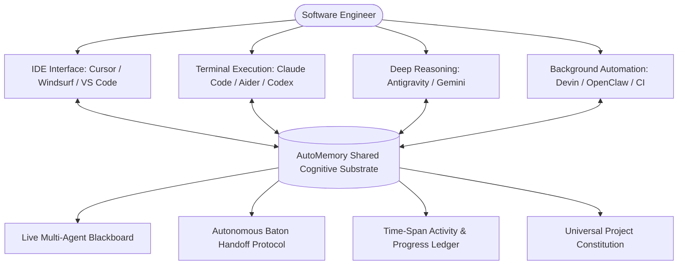

# Deep Research: Multi-Agent Coding Ecosystem Needs & Architecture

> **Author**: AutoMemory Research & Architecture Group  
> **Date**: October 2026  
> **Target**: Next-Generation Multi-Agent Coordination, Shared Working State, and Time-Span Progress Tracking for 20 Connected AI Coding Agents.

---

## 1. Executive Summary & Paradigm Shift

The software engineering industry has entered the era of the **Polyglot Multi-Agent Stack**. Developers no longer depend on a single AI coding assistant for all engineering tasks. Instead, modern software development involves multiple autonomous and semi-autonomous AI agents working across different interfaces, environments, and lifecycles on the **exact same codebase**.



While individual coding agents have become remarkably proficient at writing functions and debugging isolated errors, **multi-agent workflows today suffer from systemic fragmentation, amnesia, collision blindness, and handoff friction**.

This research outlines the architectural requirements, critical failure modes, and technical specifications necessary to turn **AutoMemory** into the foundational memory, coordination, and state layer for polyglot AI coding agents.

---

## 2. The Polyglot Agent Landscape in 2025/2026

Developers deploy specialized agents tailored to distinct modalities and interfaces:

| Agent Host / Category | Primary Modality | Typical Role in Modern Engineering | Strengths & Behavioral Characteristics |
|---|---|---|---|
| **Cursor / Windsurf / Zed** | IDE Native | **Interactive Pilot & Orchestrator** | Visual file tree context, inline completions, UI/frontend component editing, rapid human-in-the-loop review. |
| **Claude Code / Aider / Codex CLI** | Terminal Native | **Deep Execution Brain & Git Surgeon** | High-velocity terminal commands, multi-file refactors, dependency migrations, test-driven iteration, automatic git commits. |
| **Google Antigravity / Gemini** | Agentic IDE / CLI | **Architectural Partner & Subagent Swarm** | Complex multi-turn planning, artifact generation, architectural validation, hierarchical subagent delegation. |
| **Cline / Roo Code / Kilo Code** | VS Code Extension | **Task-Bound Worker** | Explicit tool permissions, localized workspace execution, task-oriented iteration. |
| **Devin / OpenClaw / Goose** | Cloud / Autonomous Daemon | **Background Worker** | Long-running issue resolution, automated test suite authoring, running overnight work loops. |

---

## 3. The 6 Fatal Failure Modes in Multi-Agent Workflows

Without a centralized, high-speed cognitive coordination substrate, working with multiple agents produces severe failure patterns:

### 3.1. Context Amnesia & The "Island Problem"
* **Scenario**: Agent A (Claude Code in the terminal) spends 45 minutes diagnosing an obscure SQLite WAL lock bug, fixes the database pragma, and discovers that foreign key cascades must be handled before transaction commits.
* **Failure**: 15 minutes later, the developer asks Agent B (Cursor in the IDE) to add a new database query. Agent B has **zero knowledge** of what Agent A learned or touched. It generates obsolete queries that re-trigger the locked pragma bug.
* **Why Static Files Fail**: Static config files (`CLAUDE.md`, `.cursorrules`, `AGENTS.md`) are static, manual, and unmaintained. Agents do not reliably update them with dynamic lessons or temporary findings in real time.

### 3.2. Concurrency Blindness & The "Stepping on Toes" Problem
* **Scenario**: The developer runs a background test refactoring task with Claude Code in terminal pane 1 while simultaneously implementing a new frontend form with Cursor in the IDE.
* **Failure**: Both agents modify files in the same directory (`src/models/` or `src/api/`) simultaneously. Neither agent is aware of the other's pending writes. One agent silently overwrites the other's uncommitted edits, creating merge conflicts, compiler errors, and broken hallucinated fixes.

### 3.3. The "Handoff Tax" (Passing the Baton Friction)
* **Scenario**: A developer finishes a terminal debugging session with Claude Code and switches to Antigravity or Cursor for architectural review and documentation.
* **Failure**: The developer must manually copy-paste long terminal transcripts and error logs.
* **Context Flooding**: Dumping 50,000 tokens of raw terminal transcripts floods the receiving agent's context window, burning massive API token budgets and triggering "lost-in-the-middle" reasoning degradation.

### 3.4. Invariant Inconsistency & Architectural Drift
* Different agents follow conflicting patterns:
  * Agent A installs packages via `yarn` while the project strictly uses `pnpm`.
  * Agent B introduces Python 3.12 syntax into a codebase pinned to Python 3.10.
  * Agent C attempts destructive commands (`git push --force`) that violate team policy.
* There is no **single universal constitution** enforced equally across all 20 agents.

### 3.5. Multi-Agent Attribution Void ("Who Did What?")
* When tests fail in CI or code breaks in production, developers cannot trace provenance:
  * Did Cursor make that change, did Claude Code run that migration, or did a background subagent introduce the regression?
  * The absence of an append-only event ledger with agent attribution makes auditing impossible.

### 3.6. Concurrency Locks & Storage Contention
* When 3 agents invoke Model Context Protocol (MCP) tools or out-of-process hooks at the exact same millisecond:
  * Naive SQLite or flat-file memory implementations crash with `database is locked` errors.
  * Multi-agent memory demands microsecond-level WAL concurrency and non-blocking in-memory ingestion.

---

## 4. The 6-Tier Memory Architecture for Multi-Agent Systems

To support multiple agents, memory cannot exist as a flat list of text snippets or a generic vector database. It must be organized into six distinct, purpose-driven tiers:

```
┌────────────────────────────────────────────────────────────────────────┐
│                   TIER 1: UNIVERSAL PROJECT CONSTITUTION               │
│   Immutable invariants, banned commands, framework versions, standards │
├────────────────────────────────────────────────────────────────────────┤
│                   TIER 2: PROCEDURAL SKILL PLAYBOOKS                   │
│   Synthesized executable procedures ("How to deploy", "How to migrate")│
├────────────────────────────────────────────────────────────────────────┤
│                   TIER 3: SHARED MULTI-AGENT BLACKBOARD                │
│   Active agent registry, soft file intent locks, active work goals     │
├────────────────────────────────────────────────────────────────────────┤
│                   TIER 4: TIME-SPAN ACTIVITY & PROGRESS LEDGER         │
│   Aggregated velocity: edits count, touched files, achievements, bugs  │
├────────────────────────────────────────────────────────────────────────┤
│                   TIER 5: BATON HANDOFF PROTOCOL                       │
│   Compact (100:1) structured state transfer from Agent A ──> Agent B   │
├────────────────────────────────────────────────────────────────────────┤
│                   TIER 6: EPHEMERAL AGENT SCRATCHPAD                   │
│   Private, in-flight reasoning steps (distilled before discard)        │
└────────────────────────────────────────────────────────────────────────┘
```

### Detailed Breakdown of Memory Tiers

#### Tier 1: Universal Project Constitution (`CONSTITUTION.md`)
* **Scope**: Global or Project-wide. Token Budget: strictly $<1,000$ tokens.
* **Contents**: Core invariants that must **never be violated by any agent** (e.g., "Always use `pnpm`", "Use Rust edition 2021", "Never drop production tables", "Autopilot mode: Strict").
* **Lifecycle**: Automatically injected into the prompt of every connected agent at boot.

#### Tier 2: Procedural Skill Playbooks (`ProceduralSkill`)
* **Scope**: Project-wide.
* **Contents**: Reusable, verified multi-step recipes mined from previous successful trajectories (e.g., "How to run integration tests with PostgreSQL in Docker", "How to recompile frontend assets").
* **Lifecycle**: Promoted autonomously when identical multi-step procedures succeed $\ge 3$ times.

#### Tier 3: Shared Multi-Agent Blackboard (`AgentBlackboard`)
* **Scope**: Live Workspace / Active Session.
* **Contents**: Real-time awareness of active agents:
  ```json
  {
    "active_agents": [
      {
        "agent": "claude-code",
        "status": "working",
        "current_goal": "Refactoring database connection pool",
        "locked_files": ["crates/automemory-core/src/db/connection.rs"],
        "lease_expires_at": "2026-10-08T11:15:00Z"
      },
      {
        "agent": "cursor",
        "status": "idle",
        "last_active": "2026-10-08T11:02:10Z"
      }
    ]
  }
  ```
* **Purpose**: Prevents file collision. If Cursor attempts to modify a file currently locked by Claude Code, the pre-tool hook issues a warning or requests confirmation.

#### Tier 4: Time-Span Activity & Progress Ledger (`TimeSpanDigest`)
* **Scope**: Time windows (last 30m, 1h, 4h, today, or session).
* **Contents**: Temporal rollups across ALL agents:
  1. **Editing Velocity**: Number of edits, tools executed, distinct files modified vs viewed.
  2. **Achievements**: Red-to-green test passes, commits generated, milestones achieved.
  3. **Failures**: Errors encountered, fixes applied, unresolved warnings.

#### Tier 5: Baton Handoff Protocol (`BatonPacket`)
* **Scope**: Explicit point-to-point or broadcast handoff between agents.
* **Contents**: A compact $<400$ token structured briefing:
  ```markdown
  ### 🎯 Baton Handoff [From: Claude Code ➔ To: Antigravity]
  - **Objective**: Implement time-span digest queries in SQLite WAL.
  - **Files Modified**: `crates/automemory-core/src/db/queries/events.rs`.
  - **Achievements**: Added `get_events_between` and verified with 56 workspace tests.
  - **Pending Issue / Blocker**: Need MCP tool schema definition for `memory.digest`.
  - **Recommended Next Step**: Expose `memory.digest` in `crates/automemory-mcp/src/tools.rs`.
  ```

#### Tier 6: Ephemeral Agent Scratchpad
* **Scope**: Private to a specific agent session.
* **Contents**: Intermediate reasoning, unverified file inspections, trial-and-error thoughts.
* **Lifecycle**: Automatically distilled 100:1 at session conclusion into Tier 2/4 and discarded to prevent context bloat.

---

## 5. Architectural Specifications for AutoMemory

AutoMemory is uniquely positioned to solve this challenge due to its pure native Rust architecture, $<2$ms CLI hook latency, and embedded SQLite WAL engine.

### 5.1. Concurrency & Storage Guarantees
* **WAL Mode & Busy Handler**: Configured with `PRAGMA journal_mode = WAL`, `PRAGMA synchronous = NORMAL`, and `busy_timeout(5000ms)`. Multiple agents can perform concurrent reads while writes queue safely without corruption.
* **Append-Only Event Ledger**: Tool calls and agent actions are inserted as immutable events (`tool_events`) with agent attribution (`agent_adapter`), session IDs, and nanosecond timestamps.

### 5.2. Multi-Agent Model Additions

```rust
// Proposed core models for multi-agent coordination

#[derive(Debug, Clone, Serialize, Deserialize)]
pub struct AgentLease {
    pub agent_adapter: String,
    pub session_id: String,
    pub active_goal: String,
    pub files_in_scope: Vec<String>,
    pub last_heartbeat: DateTime<Utc>,
    pub lease_expires_at: DateTime<Utc>,
}

#[derive(Debug, Clone, Serialize, Deserialize)]
pub struct BatonPacket {
    pub id: String,
    pub from_agent: String,
    pub target_agent: Option<String>,
    pub task_title: String,
    pub summary_of_changes: String,
    pub files_modified: Vec<String>,
    pub achievements: Vec<String>,
    pub unresolved_blockers: Vec<String>,
    pub suggested_next_step: String,
    pub created_at: DateTime<Utc>,
}

#[derive(Debug, Clone, Serialize, Deserialize)]
pub struct TimeSpanDigest {
    pub project_id: Option<String>,
    pub start_time: DateTime<Utc>,
    pub end_time: DateTime<Utc>,
    pub duration_minutes: f64,
    pub active_agents: Vec<String>,
    pub metrics: ActivityMetrics,
    pub achievements: Vec<String>,
    pub failures: Vec<TimeSpanFailureSummary>,
    pub files_modified: Vec<String>,
    pub files_inspected: Vec<String>,
    pub executive_summary: String,
}
```

### 5.3. MCP Tool Suite Enhancements

| Tool Name | Tool Purpose & Behavior in Multi-Agent Context |
|---|---|
| `memory.digest` | Returns time-span activity rollups (edits, achievements, failures) for any interval (`30m`, `1h`, `today`, `session`). |
| `memory.checkpoint` | Snapshots current session progress into a durable milestone memory with editing metrics and achievements. |
| `memory.baton.pass` | Creates a structured handoff packet summarizing what was done, what broke, and what to do next. |
| `memory.baton.pickup` | Ingests the latest pending baton packet left by another agent to resume work without manual copy-paste. |
| `memory.blackboard` | Inspects currently active agents and file intent locks to prevent concurrent write collisions. |
| `memory.save` *(Polished)* | Saves memories with category tags, linked files, milestone achievements, and resolved failures. |

### 5.4. CLI Command Suite Enhancements

```bash
# 1. Inspect activity over the last 1 hour across all connected agents
automemory memory digest --span 1h

# 2. View current active agents, goals, and soft file locks
automemory blackboard

# 3. Create an explicit handoff baton packet for the next agent
automemory baton pass --to antigravity --next "Review and test the new API endpoints"

# 4. View pending baton handoffs
automemory baton show

# 5. List memories organized hierarchically by domain, time span, or agent
automemory memory list --group-by category
automemory memory list --group-by time
automemory memory list --group-by agent
```

---

## 6. Strategic Implementation Roadmap

### Phase 1: Foundation Models & Time-Span Query Engine
- [ ] Define `TimeSpanDigest`, `ActivityMetrics`, `TimeSpanFailureSummary` in `crates/automemory-core/src/models/timespan.rs`.
- [ ] Implement `get_events_between` and session time window range queries in `db/queries/events.rs`.
- [ ] Write unit tests verifying time-span event retrieval and agent attribution filtering.

### Phase 2: Time-Span Digest Aggregation Engine
- [ ] Implement `TimeSpanDigestEngine` in `crates/automemory-core/src/extraction/timespan.rs`.
- [ ] Build heuristics for:
  - File modification tracking (counting edits, grouping by directory/module).
  - Achievement synthesis (red-to-green test passes, commit commands, build passes).
  - Failure categorization (compiler errors, exit codes, resolved vs unresolved issues).
- [ ] Generate concise, high-density Markdown digests.

### Phase 3: Multi-Agent Blackboard & Concurrency Guardrails
- [ ] Implement `AgentBlackboard` in `crates/automemory-core/src/db/queries/blackboard.rs`.
- [ ] Add soft file intent leases (`register_intent`, `release_intent`, `check_collision`).
- [ ] Enhance `pre-tool` hook in `automemory-cli/src/commands/hook.rs` to warn when an agent attempts to edit a file locked or recently touched by another agent within a short window.

### Phase 4: Baton Handoff Protocol
- [ ] Implement `BatonPacket` storage and retrieval in `crates/automemory-core/src/db/queries/baton.rs`.
- [ ] Implement `automemory baton pass` and `automemory baton pickup` in CLI.
- [ ] Add MCP tools `memory.baton.pass` and `memory.baton.pickup`.
- [ ] Update `boot` hook to automatically suggest or ingest pending baton packets when a new agent session starts.

### Phase 5: Polished Memory Save & Visual Organization
- [ ] Polish `memory.save` MCP tool to accept `category`, `achievements`, `failures_resolved`, `files_modified`.
- [ ] Add `--group-by` flags to `automemory memory list` (`--group-by category`, `--group-by time`, `--group-by agent`).
- [ ] Auto-checkpoint on `stop` lifecycle hook so agents leave a clean progress memory upon exiting.

---

## 7. Conclusion

By treating **cross-agent coordination**, **time-span activity rollups**, **collision avoidance**, and **structured handoffs** as first-class primitives, AutoMemory evolves from an individual agent memory store into the **universal cognitive nervous system for multi-agent software engineering**.
