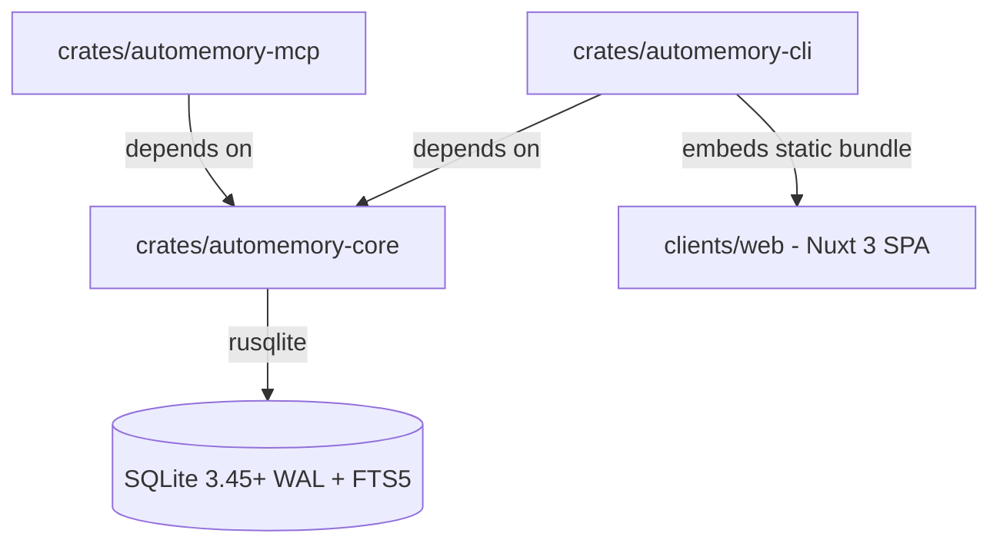
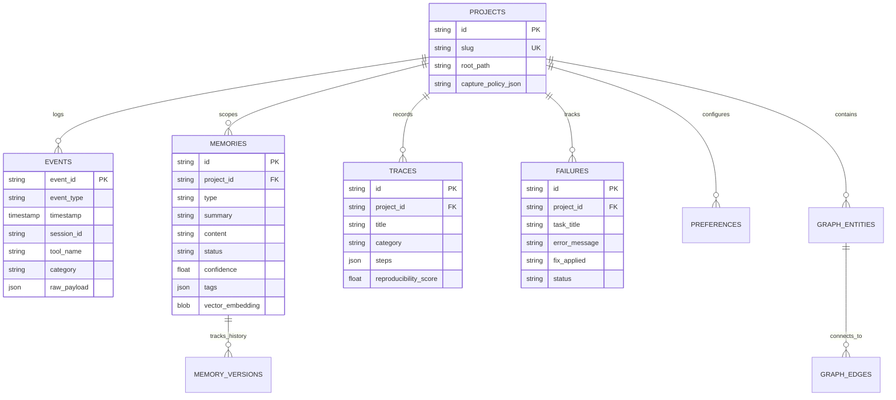

# Technical Specifications: Deep Architecture Breakdown

## 1. Crate Hierarchy & Modular Architecture

AutoMemory is written entirely in **Rust 2021 Edition** for high concurrency, memory safety, and sub-millisecond execution times. The workspace is organized into three decoupled crates:

```
automemory/
├── crates/
│   ├── automemory-core/    # Pure domain logic, SQLite storage, AST lexer, retrieval, distillation
│   ├── automemory-cli/     # Command-line interface, lifecycle hooks, Axum HTTP daemon, embedded Nuxt 3 UI
│   └── automemory-mcp/     # Model Context Protocol (MCP) server (stdio & HTTP)
├── clients/
│   └── web/                # Nuxt 3 / Vue 3 / Tailwind CSS / Pinia single-page application
```



---

## 2. SQLite Database & Storage Engine

AutoMemory stores all state locally in a single SQLite database located at `~/.automemory/automemory.db`.

### PRAGMA Optimizations
To maximize throughput and eliminate database locking during concurrent hook evaluations:
```sql
PRAGMA journal_mode = WAL;
PRAGMA synchronous = NORMAL;
PRAGMA foreign_keys = ON;
PRAGMA busy_timeout = 5000;
PRAGMA cache_size = -64000; -- 64MB cache
```

### Key Schema Tables & Virtual Tables



### Full-Text Search (FTS5) & Triggers
All memories, traces, and failures are synchronized into SQLite `FTS5` virtual tables via atomic SQLite triggers:
```sql
CREATE VIRTUAL TABLE memories_fts USING fts5(
    summary,
    content,
    tags,
    tokenize = 'porter unicode61'
);

CREATE TRIGGER memories_ai AFTER INSERT ON memories BEGIN
    INSERT INTO memories_fts(rowid, summary, content, tags)
    VALUES (new.rowid, new.summary, new.content, new.tags);
END;
```

---

## 3. AST Shell Tokenizer & Lexer ([`tokenizer.rs`](file:///Users/as/Dev/Projects/opensources/automemory/crates/automemory-core/src/guardrails/tokenizer.rs))

Rather than relying on brittle regular expressions that fail when commands are wrapped or chained, AutoMemory implements a stateful shell lexer:

### Subshell & Wrapper Unwrapping Algorithm
1. **Quote-Aware Tokenization**: Parses arguments taking into account single quotes (`'`), double quotes (`"`), escape characters (`\`), and variable brackets.
2. **Recursive Wrapper Stripping**: Iteratively peels off wrapper prefixes:
   - `sudo`, `sudo -u <user>`
   - `sh -c "<subcommand>"`, `bash -c "<subcommand>"`, `zsh -c "<subcommand>"`
   - `eval "<subcommand>"`
   - `npx --yes`, `bunx`, `pnpm dlx`
3. **Compound Chain Splitting**: Recursively splits chains on delimiters: `&&`, `||`, `;`, `|`.
4. **Structured Pattern Matching**: Evaluates the normalized token stream against AST checkers:
   - Root / Home Directory Recursive Deletion: `rm -rf /`, `rm -rf ~`, `rm -rf $HOME`, `rm -rf /*`.
   - Production Force Push: `git push -f origin main`, `git push --force remote master`.
   - Raw Disk Formats: `mkfs.ext4`, `dd if=/dev/zero of=/dev/sdX`, `fdisk`, `diskutil eraseDisk`.
   - Raw DB Drops: `DROP DATABASE`, `DROP TABLE`, `psql -c "DROP SCHEMA ..."`.
   - Database Migrations: `prisma migrate`, `alembic upgrade`, `diesel migration run`.

---

## 4. Retrieval Mathematics & Memory Decay

### A. Exponential Memory Decay Function
The active relevance score $S(m, t)$ of memory $m$ at time $t$ is calculated as:
$$S(m, t) = C_0 \cdot e^{-\lambda \Delta t} \cdot \Big(1 + \beta \cdot \ln(1 + f)\Big) \cdot P_{\text{contradiction}}$$

Where:
- $C_0$: Base confidence score ($0.0 \le C_0 \le 1.0$).
- $\Delta t$: Elapsed time in days since creation or last update.
- $\lambda$: Decay constant = $\frac{\ln(2)}{14} \approx 0.0495\text{ days}^{-1}$ (14-day half-life).
- $f$: Reference/access frequency count.
- $\beta$: Frequency boost coefficient = $0.2$.
- $P_{\text{contradiction}}$: Contradiction penalty multiplier ($0.25$ if paradigm conflict detected, $1.0$ otherwise).

### B. Reciprocal Rank Fusion (RRF) Hybrid Search
When retrieving memories, AutoMemory combines BM25 full-text rank ($R_{\text{FTS5}}$) and Sub-Word Hashing Cosine Similarity rank ($R_{\text{Vector}}$):
$$\text{RRF\_Score}(d) = \frac{1}{60 + R_{\text{FTS5}}(d)} + \frac{1}{60 + R_{\text{Vector}}(d)}$$

---

## 5. Model Context Protocol (MCP) Interface

AutoMemory implements the **MCP Specification (2024-11-05)** over both standard I/O (stdio) and HTTP JSON-RPC at `http://127.0.0.1:4545/mcp`.

### Core Tool Catalog (23 Standardized Tools)

| Tool Category | Tool Name | Description |
| :--- | :--- | :--- |
| **Search & Retrieval** | `memory.search` | Hybrid FTS5 + vector retrieval with temporal decay |
| | `memory.recall` | Multi-context memory recall with token budgeting |
| | `memory.constitution` | Hot Memory Constitution Markdown generator |
| **Procedural Skills** | `memory.skills` | Distilled procedural playbooks and workflows |
| | `trace.list`, `trace.get` | Read golden success trajectories and step logs |
| | `trace.save` | Explicitly persist repeatable multi-step procedures |
| **Failure Catalog** | `failure.list`, `failure.get` | Catalog of known bugs, error logs, and fixes |
| | `failure.save`, `failure.resolve`| Record new failure patterns or mark as resolved |
| **Memory Governance**| `memory.save`, `memory.update` | Explicit memory persistence and version tracking |
| | `memory.archive`, `memory.restore`| Memory deprecation and restoration |
| | `memory.proposals.list / decide`| Conflict resolution and human review proposals |
| **Preferences** | `preference.get`, `preference.set`| Global & project-level configuration key/values |
| | `preference.lock` | Enforce immutable rules that agents cannot overwrite |
| **Code Graph** | `graph.index`, `graph.query` | Code structural entities (functions, structs, files) |
| | `graph.neighbors`, `graph.impact` | Blast-radius impact analysis and dependency traversal |

---

## 6. Frontend SPA Dashboard Architecture

The frontend is built with **Nuxt 3 (SSR: false / Static SPA)** and bundled directly into the Rust binary using `rust-embed`.

### Key UI Features
- **Real-Time WebSocket Pulse**: Live updates over `ws://127.0.0.1:4545/ws` using typed JSON-RPC handlers.
- **Interactive Views**:
  - `/overview`: System health, active memory counts, token savings scorecard, and recent events.
  - `/skills`: Interactive procedural playbook explorer with execution steps and preconditions.
  - `/constitution`: Live rendering of the active project constitution with copy-to-clipboard prompt injection.
  - `/traces` & `/failures`: Golden trajectory explorer and failure resolution catalog.
  - `/guardrails`: Real-time simulator for command tokenization and autopilot mode configuration.
  - `/replay`: Live event stream with payload inspection and secret redaction verification.
