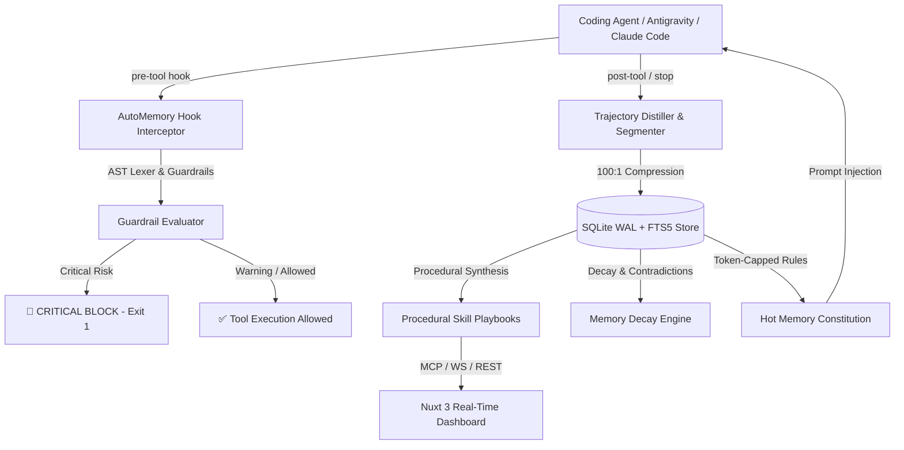

# What We Are Building: AutoMemory Pro

## 1. Executive Summary & Vision

**AutoMemory Pro** is an open-source, ultra-fast, local-first **Judgment, Safety Guardrail, Procedural Memory, and Long-Term Context Engine** engineered specifically for autonomous AI coding agents (such as Google Antigravity, Claude Code, Cursor, Copilot Workspace, Cline, and Windsurf).

Modern LLM coding agents are transitioning from interactive chat assistants to **autonomous background workers** that execute dozens or hundreds of tool actions in a single session ("vibe coding" / full-auto loops). However, existing agent memory solutions suffer from fundamental flaws:
1. **Dumb Storage Syndrome**: Traditional systems (e.g., raw vector databases or key-value stores) store passive text snippets without understanding tool execution trajectories, shell command ASTs, or behavioral workflows.
2. **Context Window Flooding**: Uncompressed agent event logs easily consume 50,000–100,000+ tokens per task, inflating API costs and causing "lost in the middle" reasoning degradation.
3. **Catastrophic Failure Vulnerability**: Autonomous agents operating in background loops can run destructive commands (`rm -rf /`, `git push origin main --force`, raw database drops, or disk formats) without semantic safety guardrails.
4. **Memory Rot & Contradiction Blindness**: As codebases evolve (e.g. migrating from Vue 2 to Vue 3 or Webpack to Vite), old memories persist indefinitely, actively misleading agents with obsolete rules.

**AutoMemory Pro solves these problems by providing an active judgment and workflow layer** that runs out-of-process alongside any coding agent.

---

## 2. Core Pillars of AutoMemory Pro

AutoMemory Pro is built on four core architectural pillars:

### Pillar 1: Active Safety & Mode-Driven Guardrails
Instead of treating safety as an afterthought, AutoMemory intercepts tool calls before execution via an AST shell lexer. It operates across three distinct autopilot modes:
- **Vibe Mode (Default for rapid prototyping)**: Only blocks catastrophic, unrecoverable actions (system root deletion, protected production force-push, raw disk wipes). High-risk operations (migrations, package upgrades) trigger non-blocking inline warnings so autonomous agent loops never get stuck.
- **Strict Mode (Production codebases)**: Blocks all high-risk commands (migrations, schema modifications, force-resets) until explicit confirmation is provided.
- **Review Mode (Human-in-the-loop)**: Enforces explicit human approval for code modifications.

### Pillar 2: Evidence-Preserving Trajectory Distillation
Agent session trajectories often contain 90% noise (exploratory greps, failed file reads, directory listings). AutoMemory's distillation engine:
- Compresses raw tool execution logs by **100-to-1** (reducing 10,000 token logs to ~100 token golden traces).
- Uses **Key-Read Anchoring**: Preserves the exact read action preceding an edit or error log, ensuring critical diagnostic evidence is never lost.

### Pillar 3: Procedural Skill Synthesis & Hot Constitution
- **Procedural Skills (`ProceduralSkill`)**: Automatically mines repeated multi-step success patterns across sessions and distills them into executable, step-by-step playbooks with trigger conditions and preconditions.
- **Hot Memory Constitution (`CONSTITUTION.md`)**: Generates an authoritative, token-budgeted (<1,000 tokens) Markdown document containing active architectural invariants, core conventions, and resolved pitfalls for instant prompt injection at agent boot.

### Pillar 4: Temporal Decay & Contradiction Detection
- **14-Day Exponential Half-Life**: Naturally decays dormant memories while boosting frequently referenced patterns through a logarithmic access function.
- **Paradigm Drift Detection**: Automatically identifies conflicting rules (e.g. Options API vs Composition API, CommonJS vs ESM) and suppresses outdated knowledge.

---

## 3. The Problem Space & Value Proposition

| Pain Point in Autonomous Coding | Traditional Vector / Key-Value Memory | AutoMemory Pro Solution |
| :--- | :--- | :--- |
| **Agent executes dangerous subshell commands** (`sudo sh -c 'rm -rf /'`) | Ignored until shell executes and destroys disk | AST shell lexer unwraps subshells and halts agent in `<2ms` with exit code 1 |
| **Agent context window fills with verbose read traces** | Floods context window with 50K+ tokens of exploratory noise | Evidence-preserving distillation compresses traces 100:1, saving 60–80% tokens |
| **Agent repeats solved bugs across sessions** | Relies on fuzzy vector search that misses structural code context | Synthesizes verified failure records and procedural skills with exact fix patterns |
| **Outdated memories give invalid advice** | Old memories rank equally with new ones, causing regressions | 14-day exponential decay + contradiction penalty suppresses obsolete paradigms |
| **Setup complexity & external dependencies** | Requires Docker, Python runtimes, Postgres/pgvector, API keys | Single, self-contained, zero-dependency Rust binary with embedded SQLite WAL and Nuxt 3 web UI |
