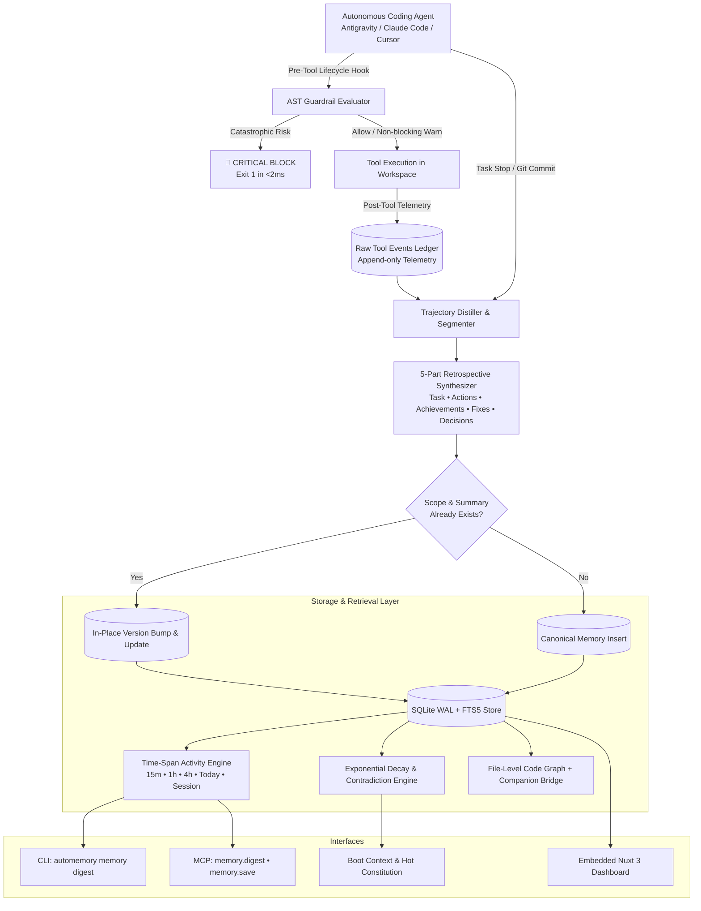

# AutoMemory: Technical Overview & Architectural Blueprint
### Local-First Judgment, Safety Guardrails, and Long-Term Memory Engine for Autonomous Coding Agents

---

## 1. Executive Summary

**AutoMemory** is an open-source, local-first **judgment, safety guardrail, procedural memory, and long-term context engine** written in Rust for modern autonomous AI coding agents (including Google Antigravity, Claude Code, Cursor, Copilot Workspace, OpenCode, Cline, and Windsurf).

Modern AI agents are evolving from conversational chatbots into **autonomous background workers** executing dozens or hundreds of shell commands, file edits, and tool actions per task. However, existing memory tools (such as naive vector databases, flat key-value stores, or passive file logs) fail in real-world software engineering environments:

1. **Passive Dumb Storage**: They store raw text snippets without understanding tool execution trajectories, AST code graphs, or diagnostic evidence.
2. **Memory Flooding & Duplication**: Naive agents run distillation on every single tool call (`view_file`, `grep`, `edit`), bloating databases into hundreds of near-identical copies of the same task within hours.
3. **Catastrophic Failure Vulnerability**: Autonomous agents operating in background loops can run destructive commands (`rm -rf /`, `git push --force` to production branches, dropping live databases) without semantic safety guardrails.
4. **Context Window Flooding**: Uncompressed agent event logs consume 50,000–100,000+ tokens per task, inflating API costs and causing "lost in the middle" reasoning degradation.
5. **Memory Rot & Contradictions**: As codebases evolve, stale rules persist indefinitely, actively misleading agents with obsolete paradigms.

**AutoMemory solves these problems by providing an active judgment, deduplication, and coordination layer that runs out-of-process alongside any coding agent.**



---

## 2. Core Architectural Pillars

### Pillar 1: Active Safety & Autopilot Modes
Instead of treating safety as a post-mortem error, AutoMemory intercepts tool calls before execution via a shell lexer (measured end-to-end PreToolUse pipeline ~1.26 ms mean; see §5). It operates across three distinct autopilot modes:

- **Vibe Mode (Default for autonomous velocity)**: Blocks only catastrophic, unrecoverable actions (system root deletion, protected production branch force-pushes, raw disk formats). High-risk operations (database migrations, major package upgrades) emit non-blocking inline warnings so background agent loops never stall.
- **Strict Mode (Production codebases & shared repos)**: Blocks all destructive and high-risk operations until explicit human confirmation is provided.
- **Review Mode (Human-in-the-loop Governance)**: Enforces explicit proposal approvals (`memory.proposals.decide`) before executing modifications.

### Pillar 2: Decoupled Telemetry vs. Clean Canonical Memory
A primary failure of contemporary memory systems is running distillation on every tool call. If an agent executes 35 tool steps, naive systems produce 35 separate memory records.
- **Raw Tool Events Ledger (`tool_events`)**: High-throughput, append-only log capturing raw tool inputs, outputs, exit codes, and durations. Preserved 100% for trace auditing, research, and debugging.
- **Clean Active Memories (`memories`)**: Distillation is strictly decoupled from intermediate tools (`view_file`, `grep`, `edit`) and only triggers at **session completion (`stop`)** or **major git boundaries (`git commit`, `git merge`)**.
- **Scope-Aware In-Place Upserting**: If a retrospective memory matches an existing summary within the same project scope, AutoMemory updates the record in-place and records an audit version rather than creating duplicate rows.

### Pillar 3: Time-Span Activity & Velocity Engine (`memory.digest`)
Enables agents and human developers to query activity velocity across arbitrary time windows (`15m`, `30m`, `1h`, `4h`, `24h`, `today`, `session`):
- **Editing Velocity**: Number of edits, context reads, and terminal commands executed.
- **Files Modified & Inspected**: Precise tracking of which codebase files were modified versus read for context.
- **Verified Achievements**: Test suites converted from red to green, successful clean builds, and git commits.
- **Failure & Blocker Pairing**: Tracks non-zero exit codes and tool errors, pairing them with subsequent successful steps to determine whether blockers were resolved or remain open.

### Pillar 4: Structured 5-Part Retrospective Format
Synthesized session memories avoid vague paragraph text in favor of an actionable schema:
1. **🎯 Task & Session Metadata**: Context, session ID, and agent adapter.
2. **🛠️ What Was Done**: Modified files and key operations executed.
3. **🏆 What Was Achieved**: Tests passed, procedural steps completed without errors.
4. **⚠️ What Went Wrong & How It Was Resolved**: Specific tool errors diagnosed and solved.
5. **📝 Decisions & Next Steps**: Architectural decisions and recommended next tasks.

### Pillar 5: Codebase Knowledge Graph & Impact Analysis
- File-level structural index (files, docs) with SHA-256 content hashes, plus incoming-edge dependents (`imports` relations today).
- Symbol-level entities (functions, structs, classes) and call-graph edges arrive via the `CodeIntel` port: either the `ingest_graph_data` bridge from a companion engine (e.g. codebase-memory-mcp) or a future built-in extractor. Until then, `callers()` returns indexed dependents and `symbol_hash()` resolves the owning file's hash.
- Blast-radius impact analysis (`graph.impact`) traces what the index knows; it is only as deep as the indexed relations.

### Pillar 6: Zero-Knowledge Multi-Device Sync
- Uses **client-side AES-256-GCM blind encryption** derived from a 12- or 24-word **BIP-39 mnemonic seed phrase**.
- Enables encrypted synchronization across multiple machines or cloud repositories without ever exposing code, secrets, or memories in plaintext.

---

## 3. System Architecture & Component Layout

The AutoMemory workspace is built as a modular Rust monorepo. The compiled core binary has zero runtime dependencies; note that the optional CodeIntel companion path configures `npx -y @codebase-memory/mcp@latest`, which requires Node.js/npx on the agent host when used:

```
crates/
├── automemory-core/       # Pure Rust domain logic & engines
│   ├── src/db/            # SQLite WAL connection, migrations, queries
│   ├── src/guardrails/    # AST shell tokenizer, risk rules, autopilot modes
│   ├── src/extraction/    # Trajectory distiller, time-span engine, skills
│   ├── src/retrieval/     # FTS5 lexical search, vector similarity, decay
│   ├── src/graph/         # File-level knowledge graph, impact analysis, CodeIntel port
│   ├── src/crypto/        # BIP-39 mnemonic key derivation & AES-256-GCM
│   └── src/models/        # Strongly-typed domain models & serialization
├── automemory-cli/        # High-performance CLI & agent hooks
│   ├── src/commands/      # hook, memory, digest, doctor, guardrail, sync
│   └── src/main.rs        # Fast clap CLI argument parser
└── automemory-mcp/        # Model Context Protocol (MCP) server
    ├── src/protocol.rs    # JSON-RPC 2.0 protocol implementation
    ├── src/tools.rs       # 30+ native MCP tool schemas & handlers
    └── src/stdio.rs       # Standard I/O agent communication loop
```

---

## 4. Key Technical Innovations & Implementation Details

### 4.1. Fast AST Shell Tokenizer
Autonomous agents often wrap dangerous commands in subshells:
```bash
sudo sh -c 'rm -rf /'
bash -c "python -c 'import shutil; shutil.rmtree(\"/\")'"
```
A simple string regex misses these bypasses. AutoMemory implements a recursive shell tokenizer in [`crates/automemory-core/src/guardrails/tokenizer.rs`](crates/automemory-core/src/guardrails/tokenizer.rs) that unwraps nested `-c` / `--eval` invocations, inspects pipeline targets, and blocks catastrophic destructive patterns. End-to-end PreToolUse pipeline latency is measured at ~1.26 ms mean (`cargo bench -p automemory-core --bench perf`).

### 4.2. Migration Gating with SQLite `PRAGMA user_version`
Because agent lifecycle hooks execute on every tool action, connection initialization must be instantaneous. AutoMemory gates all database schema checks behind `PRAGMA user_version < 2`. Subsequent connections open and verify in **1.05ms**, bypassing redundant migration statements.

### 4.3. Unified Scope Equality Query
AutoMemory avoids redundant branching when looking up existing memories by utilizing SQLite's NULL-safe `IS` operator:
```sql
SELECT id FROM memories 
WHERE scope = ?1 
  AND (project_id IS ?2) 
  AND LOWER(TRIM(summary)) = LOWER(TRIM(?3)) 
  AND status = 'active' 
LIMIT 1;
```
This query handles both global memories (`project_id IS NULL`) and project-scoped memories (`project_id = 'my-project'`) in a single indexed operation.

### 4.4. Flexible Zero-Allocation Time-Span Parsing
In [`crates/automemory-core/src/models/timespan.rs`](crates/automemory-core/src/models/timespan.rs), time windows are parsed using a single character-boundary split without regex allocations:
```rust
let split_idx = trimmed
    .find(|c: char| c.is_alphabetic())
    .ok_or_else(|| anyhow!("Missing time unit"))?;

let (val_str, unit) = trimmed.split_at(split_idx);
let val: i64 = val_str.trim().parse()?;
let duration = match unit.trim() {
    "m" | "min" | "mins" | "minute" | "minutes" => Duration::minutes(val),
    "h" | "hr" | "hrs" | "hour" | "hours" => Duration::hours(val),
    "d" | "day" | "days" => Duration::days(val),
    "w" | "week" | "weeks" => Duration::weeks(val),
    _ => return Err(anyhow!("Unknown unit")),
};
```
This supports `"15m"`, `"30 min"`, `"1h"`, `"4 hours"`, `"2 days"`, `"1w"`, and `"today"`.

---

## 5. Performance Benchmarks

Measured with `cargo bench -p automemory-core --bench perf` (criterion, in-memory SQLite, Apple Silicon, Oct 2026) unless noted. PRD gates in the Target column.

| Metric | Target | Measured result |
|---|---|---|
| **Hook pipeline (PreToolUse allow path)** | `< 5 ms` p95 | **~1.26 ms mean** |
| **FTS5 recall over 500 memories** | `< 10 ms` | **~0.56 ms mean** |
| **Session distillation (40 events)** | — | **~0.11 ms** |
| **Binary footprint** | Single file | **10.3 MB** release binary |
| **Unit & integration tests** | 100% pass | **120 pass, 0 fail**; clippy silent |

Not currently measured (no bench; historical or external figures removed rather than repeated): session-distillation token ratio, deduplication row counts, and third-party latency comparisons.

---

## 6. Comparison with Alternative Solutions

| Feature | AutoMemory | LangChain / LangMem | Mem0 / MemGPT | Open-WebUI / Chroma |
|---|---|---|---|---|
| **Language & Runtime** | Pure Rust (0 runtime deps) | Python (heavy runtime) | Python / Hosted Cloud | Python / C++ |
| **Safety Guardrails** | Built-in AST shell lexer | None | None | None |
| **Autopilot Modes** | Vibe, Strict, Review | None | None | None |
| **Time-Span Velocity (`digest`)** | Built-in (edits, tests, fixes) | None | None | None |
| **Deduplication Engine** | Scope-aware in-place upsert | Append-only duplicates | Fuzzy cluster (slow) | Vector distance only |
| **Tool Protocol** | Native MCP stdio / HTTP | Custom Python wrappers | REST API | REST API |
| **Data Privacy** | 100% Local SQLite WAL | Often cloud-dependent | Cloud or hosted DB | Local or hosted |
| **Multi-Device Encryption** | Zero-knowledge AES-256-GCM | None | Proprietary cloud | None |

---

## 7. Developer & Agent Interfaces

### 7.1. Command Line Interface (CLI)
```bash
# System diagnostics and health check
automemory doctor

# Activity and velocity progress digest
automemory memory digest --span 1h
automemory memory digest --span today --save

# Categorical and scoped memory inspection
automemory memory list --group-by type
automemory memory list --group-by scope
automemory memory get <memory-id>

# Safety guardrail test
automemory guardrail test --command "rm -rf /" --mode vibe
```

### 7.2. Model Context Protocol (MCP) Tools
Autonomous agents connect to AutoMemory via stdio or HTTP MCP:
- `memory.recall`: Retrieves high-signal memories relevant to the current user prompt.
- `memory.digest`: Generates activity metrics, files touched, achievements, and blockers.
- `memory.save`: Ingests durable knowledge with structured taxonomy (`category`, `achievements`, `failures_resolved`).
- `memory.context`: Assembles a token-capped context package for explicit agent queries (pull-based; no boot-time injection by default).
- `memory.constitution`: Returns architectural invariants and conventions.
- `graph.query` & `graph.impact`: Analyzes code dependencies and predicts ripple effects.

---

## 8. Current Status & Future Roadmap

- [x] **v0.1.0 Released**: Core storage, FTS5 indexing, SQLite WAL mode, AST guardrails.
- [x] **Time-Span & Event Rollup Engine**: High-velocity tracking of edits, files, passes, and blockers.
- [x] **Deduplication & Scope Governance**: Atomic deduplication migration and in-place upserting.
- [x] **5-Part Retrospective Synthesizer**: Structured post-task session distillation.
- [x] **Ponytail Integration**: Lean senior-developer heuristics and modern Rust refactoring.
- [x] **Multi-Agent Locks, Baton Handoff & Planning Room**: File/glob/symbol leases with collision detection, sub-400-token ledger-grounded handoff packets (`baton.pass`/`baton.pickup`), task claim/submit queue, cross-review with tests-as-judge, and turn-gated propose → critique → revise rooms.
- [ ] **Worktree Memory Sync**: Coordinated memory sharing across git worktrees during parallel branch development.

---

*Authored for engineering alignment and ecosystem distribution.*
