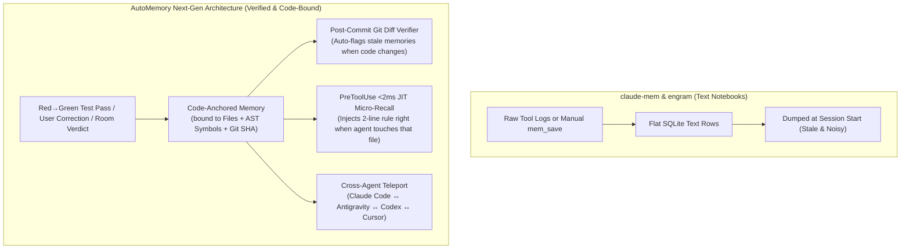

# Competitive PM & Architecture Strategy: AutoMemory vs. `claude-mem` & `engram`

- **Date & Time:** 2026-10-22 21:46 IST (`+05:30`)
- **Scope:** Product discovery, competitive teardown (`thedotmack/claude-mem`, `Gentleman-Programming/engram`, single-vendor memory), and next-generation architectural leaps for AutoMemory.
- **Related Docs:** [memory_improvement.md](memory_improvement.md), [opportunity_solution_tree.md](opportunity_solution_tree.md), [consolidation_audit.md](consolidation_audit.md), [../roadmap.md](../roadmap.md)

---

## 1. Competitive Landscape & Side-by-Side Comparison

All three systems (`claude-mem`, `engram`, and **AutoMemory**) solve **session amnesia** for coding agents using a local-first **SQLite + FTS5 + MCP + lifecycle hooks** foundation. However, they diverge sharply on **how memory is written, how trust is enforced, and whether they coordinate multiple concurrent agents**.

| Dimension | `claude-mem` (`thedotmack/claude-mem`) | `engram` (`Gentleman-Programming/engram`) | **AutoMemory** (Ours) |
|---|---|---|---|
| **Runtime & Stack** | TypeScript / Node / Bun plugin + background worker (`~/.claude-mem`) | Single Go binary + SQLite FTS5 + BubbleTea TUI (`~/.engram/engram.db`) | Single **Rust** binary (`<2ms` hook pipeline) + SQLite WAL + FTS5 + hybrid vector search + embedded **Nuxt 3 WebUI** |
| **Write-Path Model** | **Passive + Background LLM**: Hooks log every tool call; a background LLM compresses sessions into observations | **Agent-Curated**: Trusts the active agent to call `mem_save` / `mem_session_summary` explicitly (plus passive hooks) | **Zero-LLM Daemon by Default + Trust Tiers**: Deterministic extraction + agent proposals (`memory.propose`) + explicit decisions (`decision.record`). Optional `[llm]` helper *only* suggests, never writes trusted memory |
| **Trust & Security Boundary** | Anything compressed by the worker enters context automatically | Anything the agent writes via `mem_save` is trusted immediately | **4-Tier Trust Model + Human Password Gate (`PBKDF2`)**: Agent proposals stay in **Inbox** (candidate tier) until verified or human-approved. Agents cannot overwrite human rules or approve their own plans |
| **Retrieval & Progressive Disclosure** | 3-step progressive search (`search` index → `timeline` → `get_observations`) + vector/keyword search | FTS5 keyword search (`mem_search`) + session summary injection | **FTS5 BM25 + optional Embeddings** (Ollama/OpenAI/Gemini/Voyage/Cohere) + **3-tier Library** (`Summary` → `Outline` → `Full`) + path-scoped rules export (`AGENTS.md` / `CLAUDE.md`) |
| **Multi-Agent File Locks (Collision Prevention)** | None (memory only) | None (memory only) | **Real-time File Leases (`PreToolUse` hook)**: Blocks Agent B if Agent A holds a lock on `src/checkout.rs`, or when a Planning Room task locks its scoped files |
| **Multi-Agent Planning & Tasks** | None | None | **Planning Rooms (R1–R4)**: Turn-gated `propose → critique → revise → human verdict` state machine where every claim requires a cited evidence ID, producing tracked tasks with scoped file locks and verification `check_cmd` |
| **Safety Guardrails** | None | Basic write-gate owner check | **Shell AST & Command Guardrails** (`Relaxed` / `Balanced` / `Strict` modes): Intercepts dangerous commands (`git push --force`, destructive `rm`, etc.) before execution |
| **Session Continuity** | Automatic session summary injection | `mem_session_summary` + compaction survival hooks | **Continuity Briefs & Hand-off Batons** (`/continuity`): Explicit cross-agent hand-offs (e.g., Claude Code $\rightarrow$ Antigravity $\rightarrow$ Cursor/Codex) with per-agent opt-in auto-resume and local redacted transcript readers |
| **Cross-Machine Sync** | Local DB | Commits compressed JSONL chunks into `.engram/` inside the project git repo + optional Engram Cloud | **End-to-End Encrypted Git Sync** (`XChaCha20-Poly1305` ciphertext deltas to a separate git vault) so the code repo stays clean and the git host sees only ciphertext |

---

## 2. PM Diagnosis: Why Existing Agent-Memory Tools Hit a Ceiling

Empirical benchmarks (`VibeMemBench` arXiv:2609.23570, `SWE-ContextBench` arXiv:2602.08316, `ForgetEval` arXiv:2606.15903, and the `ICLR 2026 AGENTS.md evaluation`) established a critical finding: **11 out of 12 agent-memory configurations failed to beat "memory-off"**, and static context files increased token cost by ~20% with zero accuracy gain.

Using Marty Cagan's **4 Product Risks** (*Value, Usability, Feasibility, Viability*) and Teresa Torres' **Opportunity Solution Tree**, we can see why `claude-mem` and `engram` plateau:

1. **`claude-mem`'s Flaw — Unverified Passive Noise ("Memory Rot")**
   - Recording every tool call and summarizing via a background LLM fills the database with low-signal observations (*"Modified `foo.ts`"*).
   - Worse, when code is refactored two days later, the old observation remains in the database and **actively misleads** future sessions.
2. **`engram`'s Flaw — Blind Trust, Manual Discipline & Single-Agent Scope**
   - **What `engram` gets right:** A tiny, clear surface (~4 core MCP tools: `mem_save`, `mem_search`, `mem_session_summary`, `mem_context`) and zero external dependencies.
   - **Where `engram` falls short:** It relies on the agent remembering to call `mem_save`, trusts whatever an agent writes without verification, has **no code-bound staleness detection**, commits `.engram/` files directly into the code repository, and provides **no multi-agent collision prevention, planning, or command guardrails**.
3. **Global Session-Start Dumping vs. Just-In-Time (JIT) Context**
   - Injecting 2,000 tokens of project notes at `SessionStart` wastes tokens and suffers from "lost-in-the-middle" attention decay.
   - An agent does not need a database migration rule while editing a Vue button—it needs that rule **at the exact millisecond it opens or edits `crates/automemory-core/src/db/schema.sql`**.

---

## 3. Strategic Positioning: Our Unfair Moat

> **Do not compete as "a passive text notebook for one agent."**
> Position AutoMemory as **"The Verified, Code-Bound Nervous System for Multi-Agent Engineering."**

Single-vendor tools (Anthropic's `CLAUDE.md`, Cursor rules, Gemini memory) will always exist for single-agent notes. What no single vendor will build natively—and what neither `engram` nor `claude-mem` has—is:
1. **Cross-Vendor Live Continuity** (switching seamlessly between Claude Code, Antigravity, Codex, and Cursor without re-explaining).
2. **Code-Anchored, Self-Expiring Memory** (memories bound to files, AST symbols, git commits, and test exit codes).
3. **Human-Gated Trust & Parallel Coordination** (file locks, shell guardrails, and evidence-backed Planning Rooms).

---

## 4. Five Architectural & Product Leaps to Build the Best Product in the Category

### Leap 1: Just-In-Time (JIT) File-Triggered Micro-Recall (`PreToolUse`)
- **Problem Solved:** Agents forget to call `memory.search`, and session-start context dumps get ignored mid-session.
- **Architectural Change:**
  - Anchor decisions, gotchas, and notes to file paths/globs and symbol names (e.g., `crates/automemory-core/src/db/schema.sql`).
  - When an agent invokes `PreToolUse` (`Read`, `Edit`, `Write`) on `schema.sql`, the `<2ms` Rust hook looks up active memories anchored to that file (plus 1-hop symbol dependents from `codebase-memory`) and injects **at most 2 surgical lines** into the hook response:
    > `⚡ AutoMemory [schema.sql]: Decision — schema.sql runs in full on upgrade; never index a column that only a migration adds.`
  - **Causal Attribution Tracking:** Record when an injected JIT memory is followed by a clean edit and passing test (`exit == 0`), boosting its rank (`verified_helped_count++`) and decaying memories that are repeatedly ignored.

### Leap 2: Code-Bound, Self-Invalidating Memory ("Zero-Rot Engine")
- **Problem Solved:** `ForgetEval` (arXiv:2606.15903) showed that *forgetting and contradiction handling*—not retrieval—is where memory systems fail.
- **Architectural Change (Roadmap X6):**
  - Add bi-temporal validity (`valid_from`, `invalid_at`, `superseded_by`) and code anchors (`anchored_files`, `symbol_hashes`) to memories and decisions.
  - On `post-commit` (and library/file sync), compare touched files and symbol hashes against anchored memories.
  - When a function or schema changes underneath a memory, automatically mark the memory `stale / needs re-verification` so outdated advice is **never** silently injected into an agent prompt.

### Leap 3: Deterministic "Red $\rightarrow$ Green" & User-Correction Capture
- **Problem Solved:** Eliminates `claude-mem`'s 76% boilerplate noise while removing `engram`'s reliance on manual agent discipline.
- **Architectural Change:**
  1. **User Correction Detector (`UserPromptSubmit`):** Deterministically detect high-signal human corrections (*"don't use X"*, *"instead of Y, use Z"*, *"never..."*) and stage them as candidate rules tied to the files edited in that turn.
  2. **Red $\rightarrow$ Green Verification Gate:** Only prompt the agent at `PreCompact` / `Stop` to distill a reusable bugfix or skill when the ledger observes a **verified Red $\rightarrow$ Green sequence** (test/build command exits non-zero with an error signature $\rightarrow$ files edited $\rightarrow$ test/build command exits `0`). Unverified sessions never pollute the brain.

### Leap 4: Radical MCP Tool Consolidation ("6 Core Tools by Default")
- **Problem Solved:** `engram` succeeds on ease-of-use because 4 tools fit effortlessly into any model's attention budget. Exposing 40+ MCP tools consumes thousands of tokens per turn and lowers tool-selection accuracy ([consolidation_audit.md A4](consolidation_audit.md)).
- **Architectural Change:**
  - Ship a **Compact MCP Profile (Default)** exposing only **6 high-leverage tools** (while keeping all existing tool names functional as hidden backward-compatible aliases):
    1. `memory.recall` — Unified search (`scope: all | notes | decisions | library | chat`).
    2. `memory.record` — Unified write (`kind: decision | note | gotcha`, with `files[]` and `evidence[]`).
    3. `continuity.brief` — Read or update the cross-agent handoff brief (*Goal, Decided, Ruled Out & Why, Next Step*).
    4. `library.read` — Progressive 3-tier doc reader (`summary | outline | full`).
    5. `coord.lock` — Claim/release file locks or tasks (`action: claim | release | status`).
    6. `room.turn` — Check pending turn, read brief, or post in a Planning Room.
  - Cuts MCP tool schema token overhead by **~80%** on every agent turn.

### Leap 5: Worktree-Native Parallel Execution & 1-Command Cross-Agent Teleport
- **Problem Solved:** Directly targets the #1 ranked opportunity in [opportunity_solution_tree.md](opportunity_solution_tree.md) (**O1: Switch agents mid-task without re-explaining**, score `0.63`) and parallel agent isolation (**O2**, Roadmap X4).
- **Architectural Change:**
  - **1-Command Switch (`automemory handoff --to claude|codex|agy`):** Extracts the latest state from the active agent's transcript into the structured Continuity Brief (*Goal, Decided, Ruled Out & Why, Files Modified, Next Step*) and primes the target agent immediately.
  - **Task-Bound Worktrees (`automemory worktree`):** When an agent claims a Planning Room task, optionally provision an isolated `git worktree` wired to the shared AutoMemory SQLite database, performing pre-merge symbol-overlap checks across active worktrees before branches collide.

---

## 5. Prioritized Execution Roadmap

| Priority | Initiative | Core Value | Success Metric |
|---|---|---|---|
| **P0** | **JIT File-Triggered Micro-Recall (`PreToolUse`) + Recall Telemetry** | Delivers surgical rules at the exact moment an agent edits a file, with zero session-start bloat | Recall use rate $>50\%$; `<2ms` hook latency preserved |
| **P1** | **Bi-Temporal Validity (`valid_from` / `invalid_at`) + Post-Commit Stale Verifier** | Prevents "memory rot" when code evolves underneath stored notes | Stale-flag precision $\ge 90\%$; zero invalid notes returned in recall |
| **P2** | **Compact 6-Tool Default MCP Surface (with legacy aliases)** | Cuts per-turn MCP schema tokens by ~80%; matches `engram`'s simplicity with AutoMemory's power | MCP `tools/list` payload $<1,200$ tokens in default mode; 100% contract test pass |
| **P3** | **Deterministic User-Correction & Red$\rightarrow$Green Capture Gate** | Replaces boilerplate tool-call memories with verified bugfixes and human rules | Boilerplate memory ratio $<10\%$ |
| **P4** | **Task-Bound Git Worktrees (`automemory worktree`)** | Enables parallel agents to edit overlapping files safely in isolated worktrees | Zero silent overwrites; pre-merge overlap warning tested in E2E scenario |
